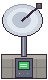

# Satellite Dish Reminders

A Stardew Valley mod that adds a **Satellite Dish** building to your farm. Use its console to set reminders, and they pop up in the bottom-left corner of the screen at the in-game time you choose.

<p align="center">
  
</p>

Never forget to refill the pet bowl, check the Traveling Cart, or pick up your ancient fruit again.

## Features

- **A new building from Robin.** Order it at the Carpenter's Shop like any other farm building.
- **In-game reminder editor.** Click the dish's console to add, edit, and delete reminders.
- **Flexible schedules.** A reminder can repeat:
  - every day
  - every week on a chosen weekday
  - every season on a chosen day (1–28)
  - once, on a specific date (it deletes itself after it fires)
- **Unobtrusive pop-ups.** Reminders appear as info boxes in the bottom-left corner with a soft chime. They stack, fade out after a while, and close with a click.
- **Missed one-time reminders still show up.** If you weren't playing on the day a one-time reminder was due, you'll see it the next time you load in.
- **Multiplayer friendly.** Reminders are saved per save file and per player, so every farmhand has their own list.

## Requirements

- [Stardew Valley](https://www.stardewvalley.net/) 1.6 or later
- [SMAPI](https://smapi.io/) 4.0 or later

## Installation

1. Install [SMAPI](https://smapi.io/) if you haven't already.
2. Download the latest release from the [Releases page](https://github.com/owencread/Stardew-Satellite/releases), or build it yourself (see [Building from source](#building-from-source)).
3. Unzip it into your `Stardew Valley/Mods` folder, so you end up with `Mods/SatelliteDish/`.
4. Launch the game through SMAPI.

## How to use

1. **Build the dish.** Visit Robin and choose *Construct Farm Buildings*, then pick **Satellite Dish**.

   | Cost | Materials | Build time | Size |
   |---|---|---|---|
   | 15,000g | 10 Iron Bar, 5 Refined Quartz, 2 Battery Pack | 2 days | 3×3 tiles |

2. **Open the console.** Stand below the dish and right-click the green screen on its front.
3. **Add a reminder.** Type a message, choose how often it repeats and at what time, then click **Add**.
4. **Edit or delete.** Click a reminder in the list to load it into the editor, then click **Save**. Click the red **X** to delete it.

When a reminder is due, it appears in the bottom-left corner. Click the box to dismiss it.

## Configuration

SMAPI creates `config.json` in the mod's folder the first time you launch the game. You can edit it with any text editor.

| Setting | Default | Description |
|---|---|---|
| `DisplaySeconds` | `20` | How many seconds a reminder stays on screen. `0` keeps it up until you click it. |
| `MaxVisible` | `3` | Maximum number of reminder boxes shown at once. |
| `PlaySound` | `true` | Play a chime when a reminder appears. |
| `RequireDish` | `true` | Only show reminders while a completed Satellite Dish exists. |
| `InstantBuild` | `true` | Robin finishes the dish instantly instead of taking 2 days. This is meant for testing. |

## Building from source

**You'll need** the [.NET 6 SDK](https://dotnet.microsoft.com/download/dotnet/6.0), plus Stardew Valley and SMAPI installed.

```bash
git clone https://github.com/owencread/Stardew-Satellite.git
cd Stardew-Satellite/SatelliteDish
dotnet build
```

The project uses [Pathoschild.Stardew.ModBuildConfig](https://www.nuget.org/packages/Pathoschild.Stardew.ModBuildConfig). It finds your game install automatically and copies the built mod into your `Mods` folder.

If it can't find the game, add your install path to `SatelliteDish.csproj`:

```xml
<PropertyGroup>
  <GamePath>C:\Program Files (x86)\Steam\steamapps\common\Stardew Valley</GamePath>
</PropertyGroup>
```

### Project layout

```
SatelliteDish/
├── ModEntry.cs        # Adds the building, the console action, reminder timing and events
├── ReminderMenu.cs    # Console menu: reminder list and editor
├── ReminderHud.cs     # Bottom-left reminder pop-ups
├── Reminder.cs        # Reminder model and per-player JSON storage
├── ModConfig.cs       # config.json settings
├── manifest.json
└── assets/
    └── SatelliteDish.png   # 48×80 building sprite (the bottom 48px is the 3×3 footprint)
```

## Known limitations

- The console menu supports mouse and keyboard only. Controller navigation isn't supported yet.
- In multiplayer, the chat box also uses the bottom-left corner and can overlap reminders.
- English only for now.

## Roadmap

- [ ] Controller support in the console menu
- [ ] [Generic Mod Config Menu](https://www.nexusmods.com/stardewvalley/mods/5098) integration
- [ ] Translations (i18n)
- [ ] Final building art
- [ ] Reminders tied to villager birthdays and festivals

## Contributing

Issues and pull requests are welcome. If you find a bug, please include your SMAPI log from [smapi.io/log](https://smapi.io/log).
